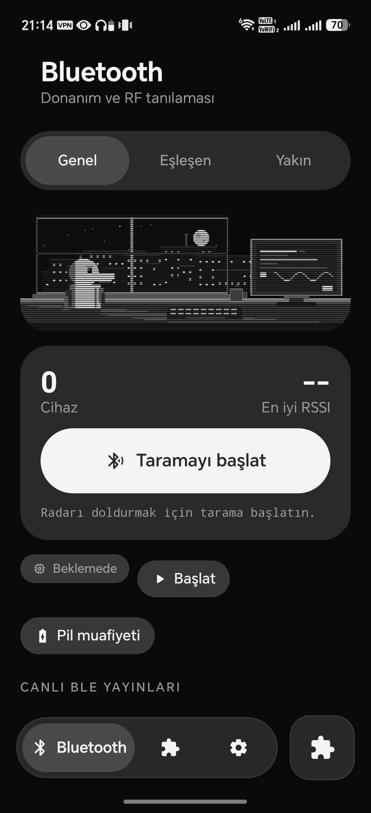
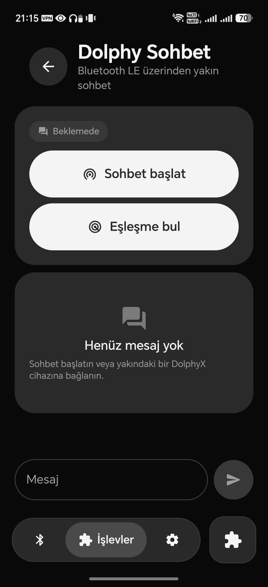
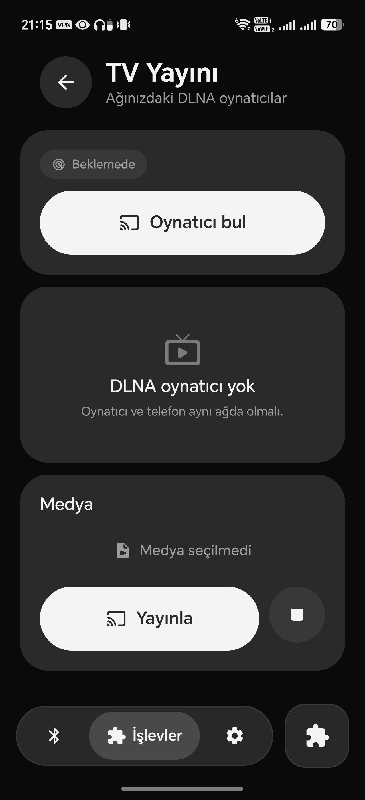
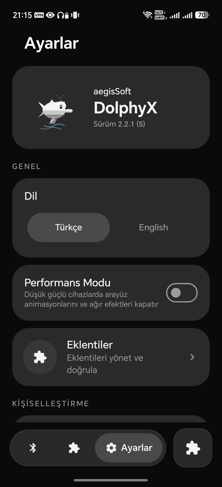

<p align="center">
  
</p>

<h1 align="center">DolphyX</h1>

<p align="center">
  <strong>Monochrome hardware &amp; RF diagnostic suite for Android — BLE, IR, NFC, HID, LAN, IPP, DLNA.</strong><br>
  <em>Android için monokrom donanım ve RF tanı paketi — BLE, IR, NFC, HID, LAN, IPP, DLNA.</em>
</p>

<p align="center">
  <a href="https://github.com/MrSpy00/DolphyX/releases"></a>
  <a href="LICENSE"></a>
  <a href="https://developer.android.com/about/versions/16"></a>
  <a href="https://kotlinlang.org"></a>
  <a href="https://aegissoft.com.tr"></a>
  <a href="https://github.com/MrSpy00"></a>
</p>

<p align="center">
  <a href="#-türkçe"> <strong>Türkçe</strong></a>
  &nbsp;&nbsp;&nbsp;
  <a href="#-english"> <strong>English</strong></a>
</p>

<p align="center">
  
  
  
  
</p>

---

<h1 align="left"> Türkçe</h1>

## Genel Bakış

**DolphyX**, [unvoiddd/Dolphy-App](https://github.com/unvoiddd/Dolphy-App) projesini temel alan; orijinalin monokrom tasarım dilini koruyup üzerine yeni modüller, hata düzeltmeleri ve güvenlik iyileştirmeleri ekleyen bağımsız bir **aegisSoft** geliştirmesidir. Bu depo, temel alınan projenin bir türevi/modifiye sürümüdür; orijinal geliştiriciye ve GPL-3.0 lisansına saygı gösterir.

Uygulama; kök (root) gerektirmeden BLE, kızılötesi, NFC, Bluetooth HID, yerel ağ, IPP yazdırma ve DLNA yayınını tek bir monokrom arayüzde toplar. Tüm işlemler cihaz üzerinde ve yerel ağda çalışır; bulut hesabı, telemetri veya reklam yoktur.

**Dokümantasyon:** [Proje özeti](docs/PROJECT.md) · [Tasarım sistemi](docs/DESIGN_SYSTEM.md) · [Özellik matrisi](docs/FEATURE_MATRIX.md) · [Test ve doğrulama](docs/TESTING.md)

## Öne Çıkanlar

| Modül | Yetenek |
| :--- | :--- |
| **Bluetooth / BLE** | Eşleşmiş cihaz önceliği, RSSI, OUI üretici çözümleme, GATT servis/karakteristik keşfi |
| **Dolphy Chat** | BLE GATT üzerinden yakın sohbet; sunucu + istemci, yeni satır çerçeveleme |
| **IR** | 2.460 kumanda / 58.766 sinyal; 45 kategori, marka/model arama, favoriler, evrensel kumanda, 8 protokol + raw özel sinyal, Flipper `.ir` içe aktarma |
| **NFC** | Etiket okuma (UID/tech/NDEF), metin/URL/Wi-Fi/vCard yazma, silme, AES-256-GCM kasası, Type-4 HCE |
| **HID** | Eşleşmiş PC/TV için Bluetooth klavye, medya tuşları, trackpad |
| **Ağ** | TCP port yoklama, HTTPS kontrolü, `/24` LAN taraması, DNS/TLS incelemesi |
| **Yazıcı** | IPP/AirPrint mDNS keşfi + gerçek IPP Print-Job (PDF/metin/görsel) |
| **Kamera** | RTSP/ONVIF mDNS keşfi, elle RTSP adresi, harici oynatıcıya devir |
| **Cast** | SSDP DLNA keşfi, AVTransport ile TV'ye yayın, Range destekli yerel HTTP sunucusu |
| **QR** | Saf Kotlin QR üretimi, token korumalı yerel paylaşım sunucusu |
| **Eklenti** | Kanonik SHA-256 + yetki beyaz listesi; kod çalıştırma yok |
| **Widget** | IR/NFC/uygulama kısayolları; `exported=false` |

## Tasarım

- **Monokrom OLED:** `#0A0A0A` zemin, `#2A2A2A` kartlar, 28dp köşe, beyaz 64dp pill butonlar.
- **Kapsül dock:** Aktif sekme genişler; kare FAB görünürlüğü ve eylemi ayarlanabilir.
- **Kişiselleştirme:** 5 vurgu (Rainbow varsayılan, Orange, Red, Green, Purple), Flipper pixel font, %85–135 arayüz ölçeği, reduce motion, Functions Containers/Tiles ve Standard/Compact.
- **Pixel sanat:** Aseprite ile üretilen maskot ve banner (`px_dolphin.png`, `px_scene.png`).
- **Erişilebilirlik:** Edge-to-edge + `safeDrawingPadding()`, 48dp dokunma hedefleri, kesilmeyen metinler, sıfır emoji.
- **Diller:** Türkçe ve İngilizce tam string eşitliği (540 anahtar).

## Savunmacı Kapsam

Aşağıdaki saldırı/suistimal bileşenleri **bilinçli olarak yoktur**: BLE spam/jammer, TWS hijack, BadUSB/DuckyScript, phishing, yetkisiz kamera/router brute-force, kısıtlamasız root/Shizuku/Rhino/Python/DEX çalıştırma. IR jammer kategorisi veritabanından filtrelenir.

## Kurulum ve Derleme

**Gereksinimler:** JDK 17, Android SDK 36, Gradle Wrapper (depoda hazır).

```bash
git clone https://github.com/MrSpy00/DolphyX.git
cd DolphyX
```

```powershell
# 35 birim testi
.\gradlew.bat testDebugUnitTest

# Debug APK
.\gradlew.bat assembleDebug

# Release APK
.\gradlew.bat assembleRelease
```

Çıktılar:

- `app/build/outputs/apk/debug/app-debug.apk`
- `app/build/outputs/apk/release/app-release.apk`

Kurulum:

```powershell
adb install -r app\build\outputs\apk\debug\app-debug.apk
adb shell am start -n com.aegissoft.dolphyx.debug/com.aegissoft.dolphyx.MainActivity
```

Üretim imzası için `keystore.properties` veya `DOLPHYX_KEYSTORE_*` ortam değişkenleri kullanılabilir; ardından `.\build_and_install.ps1`.

## Proje Yapısı

```text
DolphyX/
├── app/src/main/java/com/aegissoft/dolphyx/
│   ├── core/{config,security,service}   # BuildConfig, Keystore AES-256-GCM, FGS
│   ├── data/                            # IRDB, OUI, NFC kasası, özel IR kayıtları
│   ├── engine/
│   │   ├── ble/                         # BLE tarayıcı + Dolphy Chat
│   │   ├── ir/                          # Protokol kodlayıcı, verici, .ir içe aktarma
│   │   ├── nfc/                         # Okuyucu, NDEF yazıcı, HCE
│   │   ├── hid/                         # Bluetooth HID
│   │   ├── cast/                        # DLNA + yerel medya sunucusu
│   │   └── network/                     # LAN, mDNS, IPP, RTSP, QR
│   └── ui/{theme,components,screens,widget}
├── docs/                                # Tasarım, eşitlik matrisi, raporlar, ekranlar
├── tools/                               # Aseprite pixel sanat betikleri
└── scripts/                             # Varlık paketleme
```

## DoÄŸrulama

- **35/35 JUnit 4 testi** başarılı.
- Honor Magic `PTP-N49` (Android 16 / API 36) üzerinde tüm rotalar açıldı: `home, tools, settings, ble, chat, ir, nfc, network, hid, lan, printer, camera, cast, plugins` — **0 fatal**.
- BLE taraması canlı 51 cihaz buldu; IR kategorisi → marka → model → tuş gönderimi doğrulandı; QR sunucusu ve Chat hosting başlatıldı.

## Ekran Görüntüleri

| Bluetooth | Functions | IR | Chat |
| :---: | :---: | :---: | :---: |
|  |  |  |  |

| Yazıcı | Kamera | Cast | Ayarlar |
| :---: | :---: | :---: | :---: |
|  |  |  |  |

---

<h1 align="left"> English</h1>

## Overview

**DolphyX** is an independent **aegisSoft** project based on [unvoiddd/Dolphy-App](https://github.com/unvoiddd/Dolphy-App). It keeps the original monochrome design language and adds new modules, bug fixes, and security hardening on top. This repository is a modified derivative of the upstream project and credits the original author and its GPL-3.0 license.

The app brings BLE, infrared, NFC, Bluetooth HID, local networking, IPP printing, and DLNA casting into one monochrome interface without root. Everything runs on-device or on the local network; there is no cloud account, telemetry, or advertising.

**Documentation:** [Project overview](docs/PROJECT.md) · [Design system](docs/DESIGN_SYSTEM.md) · [Feature matrix](docs/FEATURE_MATRIX.md) · [Testing & verification](docs/TESTING.md)

## Highlights

| Module | Capability |
| :--- | :--- |
| **Bluetooth / BLE** | Bonded-device priority, RSSI, OUI vendor lookup, GATT service/characteristic discovery |
| **Dolphy Chat** | Nearby chat over BLE GATT; server + client, newline framing |
| **IR** | 2,460 remotes / 58,766 signals; 45 categories, brand/model search, favorites, universal remote, 8 protocols + raw custom signals, Flipper `.ir` import |
| **NFC** | Tag reading (UID/tech/NDEF), text/URL/Wi-Fi/vCard writing, erase, AES-256-GCM vault, Type-4 HCE |
| **HID** | Bluetooth keyboard, media keys, and trackpad for a paired PC/TV |
| **Network** | TCP port probe, HTTPS check, `/24` LAN scan, DNS/TLS inspection |
| **Printer** | IPP/AirPrint mDNS discovery + real IPP Print-Job (PDF/text/image) |
| **Camera** | RTSP/ONVIF mDNS discovery, manual RTSP address, hand-off to an external player |
| **Cast** | SSDP DLNA discovery, AVTransport playback, Range-capable local HTTP server |
| **QR** | Pure Kotlin QR generation, token-protected local share server |
| **Plugins** | Canonical SHA-256 + permission allowlist; no code execution |
| **Widget** | IR/NFC/app shortcuts; `exported=false` |

## Design

- **Monochrome OLED:** `#0A0A0A` background, `#2A2A2A` cards, 28dp corners, white 64dp pill buttons.
- **Capsule dock:** Active tab expands; square FAB visibility and action are configurable.
- **Personalisation:** 5 accents (Rainbow default, Orange, Red, Green, Purple), Flipper pixel font, 85–135% UI scale, reduce motion, Functions Containers/Tiles and Standard/Compact styles.
- **Pixel art:** Aseprite-generated mascot and banner (`px_dolphin.png`, `px_scene.png`).
- **Accessibility:** Edge-to-edge + `safeDrawingPadding()`, 48dp touch targets, no clipped text, zero emoji.
- **Languages:** Full Turkish and English string parity (540 keys).

## Defensive Scope

The following attack/abuse components are **intentionally absent**: BLE spam/jammer, TWS hijack, BadUSB/DuckyScript, phishing, unauthorized camera/router brute force, and unrestricted root/Shizuku/Rhino/Python/DEX execution. The IR jammer category is filtered from the database.

## Build & Install

**Requirements:** JDK 17, Android SDK 36, Gradle Wrapper (included).

```bash
git clone https://github.com/MrSpy00/DolphyX.git
cd DolphyX
```

```powershell
# 35 unit tests
.\gradlew.bat testDebugUnitTest

# Debug APK
.\gradlew.bat assembleDebug

# Release APK
.\gradlew.bat assembleRelease
```

Outputs:

- `app/build/outputs/apk/debug/app-debug.apk`
- `app/build/outputs/apk/release/app-release.apk`

Install:

```powershell
adb install -r app\build\outputs\apk\debug\app-debug.apk
adb shell am start -n com.aegissoft.dolphyx.debug/com.aegissoft.dolphyx.MainActivity
```

For release signing use `keystore.properties` or the `DOLPHYX_KEYSTORE_*` environment variables, then run `.\build_and_install.ps1`.

## Verification

- **35/35 JUnit 4 tests** pass.
- All routes opened on a Honor Magic `PTP-N49` (Android 16 / API 36): `home, tools, settings, ble, chat, ir, nfc, network, hid, lan, printer, camera, cast, plugins` — **0 fatal**.
- Live BLE scan found 51 devices; IR category → brand → model → key transmission was exercised; QR server and Chat hosting started successfully.

## Privacy & Security

- No analytics, ads, accounts, or cloud sync.
- Sensitive preferences and the NFC vault are encrypted with AES-256-GCM via Android Keystore.
- Cleartext HTTP is blocked globally; only the loopback QR server is allowed.
- HCE requires device unlock; exported components are minimized (`RECEIVER_NOT_EXPORTED`, `exported=false` widget).
- Chat and local media stay on the device/LAN; chat transport is currently unencrypted at the BLE link layer (documented limitation).

## Screenshots

See the Turkish section above; the same images are used for both languages.

---

## Credits & License / Emeği Geçenler ve Lisans

This project is based on **[unvoiddd/Dolphy-App](https://github.com/unvoiddd/Dolphy-App)** (GPL-3.0). The original project and its author are credited for the concept, feature set, and design language. DolphyX is an independent derivative with substantial modifications, new modules, and fixes by **aegisSoft / mrSpy** (2026). See [NOTICE](NOTICE) for the modification statement.

Bu proje **[unvoiddd/Dolphy-App](https://github.com/unvoiddd/Dolphy-App)** (GPL-3.0) projesini temel alır. Konsept, özellik seti ve tasarım dili için orijinal proje ve geliştiricisi anılır. DolphyX; **aegisSoft / mrSpy** tarafından kapsamlı değişiklikler, yeni modüller ve düzeltmeler içeren bağımsız bir türevdir (2026). Değişiklik beyanı için [NOTICE](NOTICE) dosyasına bakın.

- **License:** [GNU General Public License v3.0](LICENSE)
- **Upstream:** <https://github.com/unvoiddd/Dolphy-App>
- **Developer:** [aegisSoft](https://aegissoft.com.tr) · [mrSpy](https://github.com/MrSpy00)

<p align="center">
  <sub>DolphyX is not affiliated with or endorsed by the upstream author or any hardware vendor.<br>
  DolphyX, orijinal geliştirici veya herhangi bir donanım üreticisiyle bağlantılı değildir.</sub>
</p>
